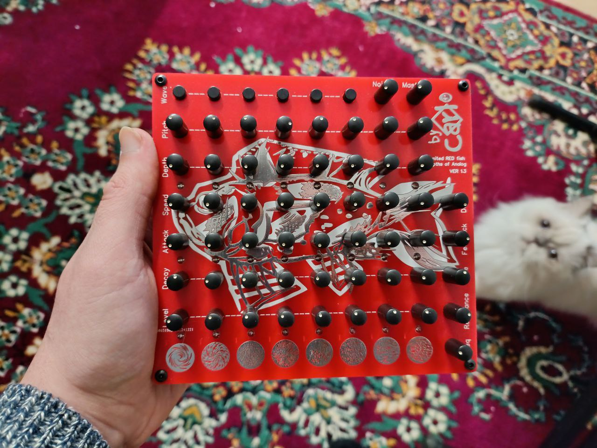
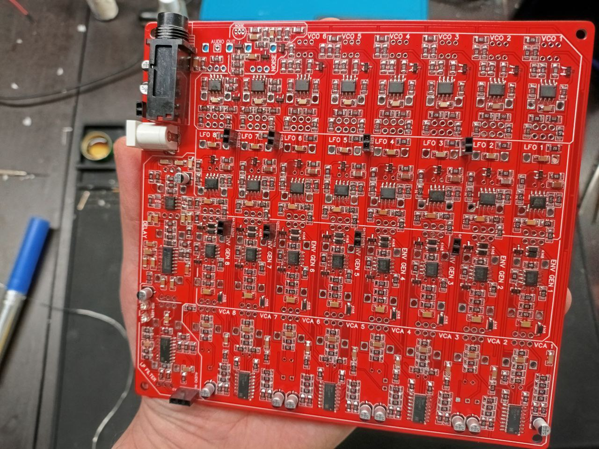
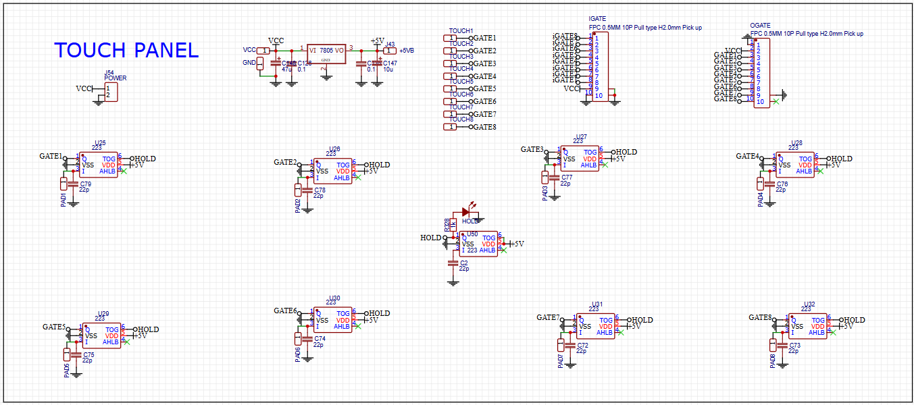
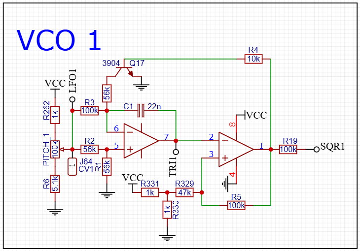
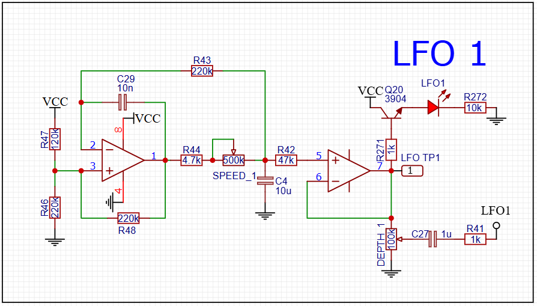
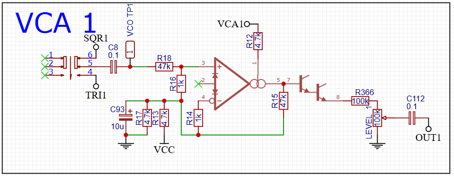
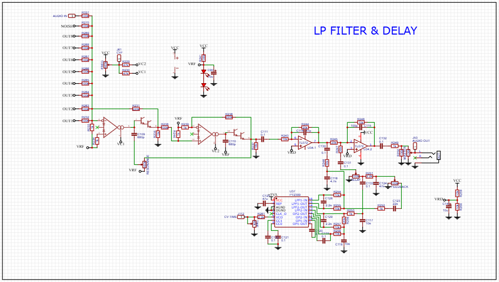
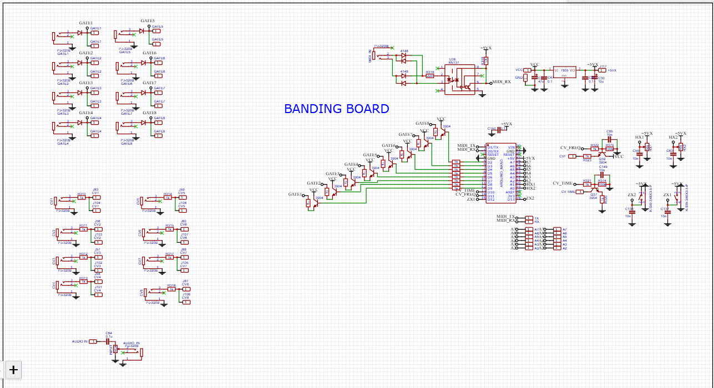

Hello. 
I made a polyphonic synth from improvised and cheap parts. 
It came out musically enough. 
Now I am often asked to build, but I’m not interested, so I posted the entire project for self-assembly.

This is a polyphonic subtractive synthesizer for 8 voices.

Each voice is a monophonic subtractive synthesizer, parallelly combined into a common low-pass filter and has on board:

An oscillator with adjustable pitch and switchable waveform (Triangle/Square) 
An LFO with speed and depth controls to modulate the pitch of the oscillator. 
An envelope generator with attack and decay speed adjustments to control the VCA. 
Individual volume control for each voice. 
To control the envelope generator, capacitive sensors are used, which can operate in two modes (hold or momentary). 
Eight such voices are combined into a single low-pass filter and delay. I have also added an independent knob for adding white noise. 
Each voice can be controlled by CV/GATE which is set to each voice. 

Technicial Specifications:
+ 8 Polyphony
+ 8 Analog VCO
+ 2 Waveforms VCO
+ 8 Analog LFO (Speed/Depth)
+ 8 Analog Envelope (Attack/Decay)
+ 8 Analog VCA
+ 8 Channel Mixer
+ 8 Sensor touch panel
+ 1 White noise generator
+ 1 Analog LP Filter
+ 1 Delay PT2399
+ 8 CV inputs
+ 8 GATE inputs
+ Can work with adapter 9V
+ Mono Output (6.3mm jack)
+ Circuit banding area (bread board)

The synthesizer consists of 3 PCB on which all components are placed. 
The circuit is completely analog, so a lot of components came out (about 750)

Below is some information about the circuit that I used.

For sensors, I used TTP223 microcircuits, because they are affordable and can work in two modes (hold and momentary) 
You can set the sensitivity of the capacitors 

The VCO was made on one OpAmp LM358, according to some of the simplest schemes from the Internet, but it works well and gives out two signals (a triangle and a square)

To modulate the pitch, I made an LFO. 
I also used LM358 and added a speed indication through a transistor.

Then the signal is sent to the VCA, I could not find a suitable working example that would work well from + 9v, so I had to experiment, but I was satisfied with the result, this circuit works stably. 
I used lm13700 because they are clear to me and work in different voltage ranges.

To control the VCA, I needed an envelope generator, I also decided to use the lm358 and made a fairly classic circuit, but I used only a single-polar supply. 
I also added an indication of operation through a transistor, as in the LFO.

I made 8 of these heads and decided that something was missing. 
Therefore, I decided to add a white noise generator, I took a circuit from a noise toaster from mfos. 
I liked the 2n5551 transistors, they are cheap, affordable and always stable noise.

It still wasn’t enough for me. 
Then I decided to add a filter and a delay. 
I used quite popular schemes, I think many of them collected them.

I liked the result and many musicians were interested in the project, so I decided to share it with you.

I connected MIDI only to version 1.3 and used an Arduino Nano, 6N137 and several transistors to reduce the current load on the Arduino.

I sent out about 10 build kits and everyone did it just like me, even the most beginners.
The assembly is not difficult, but it took me about 15 hours.