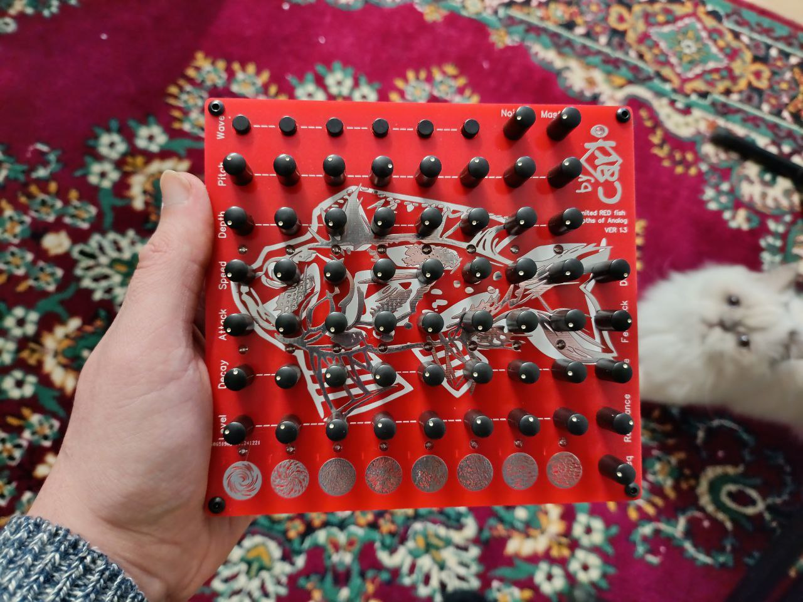
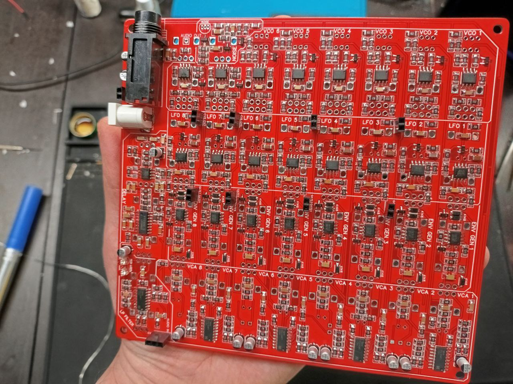
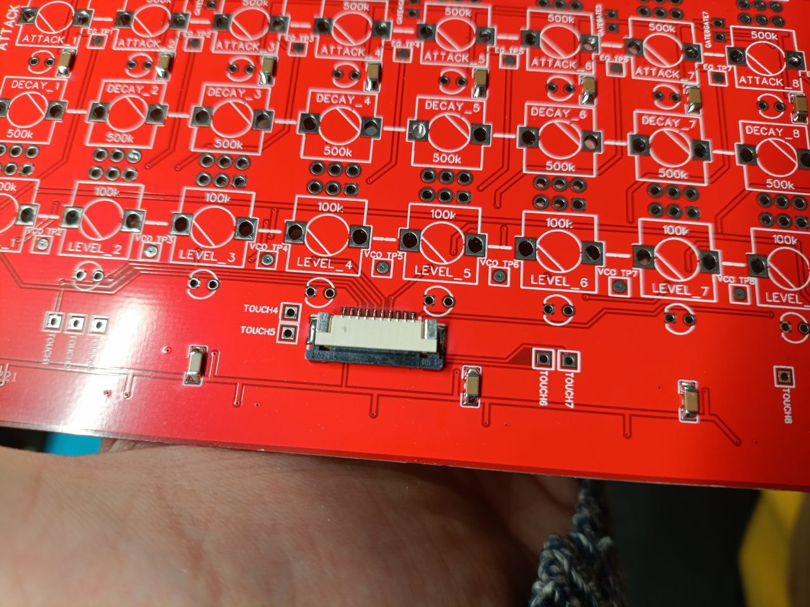
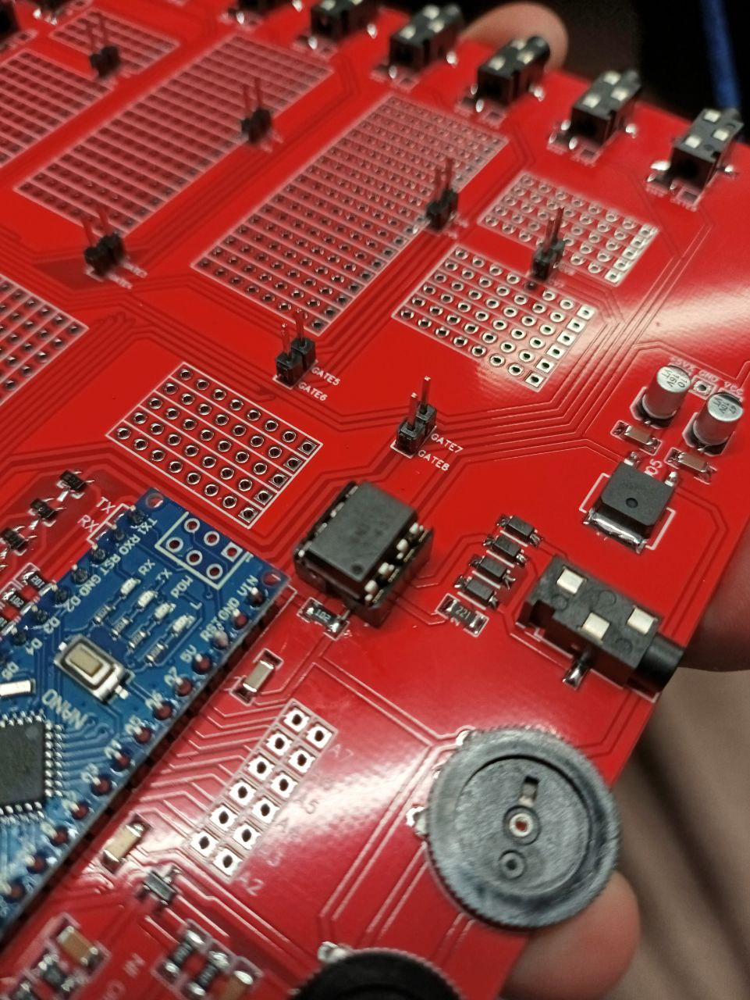

# Mushsynth-8 — Analog Polyphonic Drone Synthesizer

#### Mushsynth-8 is a fully analog 8-voice polyphonic drone synthesizer with a touch keyboard.
##### You can build it yourself — all necessary files are available on my GitHub.

This is an updated version 1.3.
It eliminates the wired connection, optimizes component values, adds a universal MIDI input (gates only), an external audio input, and a more convenient FFC cable.

Each voice is an independent monophonic subtractive synthesizer, combined into a common low-pass filter and delay.
The instrument was intentionally designed using simple and affordable components, making it easy to assemble and modify.

**Main Features:**
+ 8 analog VCOs (Triangle / Square waveform)
+ 8 LFOs with speed and depth control for oscillator modulation
+ 8 envelope generators (Attack / Decay) for individual VCAs
+ 8 individual volume controls
+ Capacitive touch sensors (two modes — hold and momentary)
+ Common low-pass filter and delay (PT2399)
+ White noise generator with separate level control
+ CV / GATE inputs for each voice
+ Mono output (6.3 mm jack)
+ Powered by 9V adapter
+ Prototype area (breadboard) for experiments
+ MIDI 3.5mm universal polarity (Only GATE's)
+ External audio input

**Control Elements**
+ **Per Voice:** Wave, Pitch, Depth, Speed, Attack, Decay, Level
+ **Global:** Noise, Master, Delay (Time / Feedback / Level), Filter (Freq / Resonance)

**Indicators**
+ Touch / Gate status

**LFO activity**
+ Envelope activity

#### Below are the links to information on what is needed for assembly, how it works, and other details.

### [How it works](https://github.com/EugeneCarlo/Mushsynth-8_voice_drone_synth/blob/main/How_it_works/README.MD)
### [Full Schematic in PDF](Schematic/Schematic_Mushsynth-8-(1.3-ver).pdf)
### [BOM](https://github.com/EugeneCarlo/Mushsynth-8_voice_drone_synth/blob/main/BOM/README.MD)
### [GERBER - Top Panel](https://github.com/EugeneCarlo/Mushsynth-8_voice_drone_synth/raw/main/PCB/Gerber_Mushsynth-8-(1.3-ver)_PCB_Top.zip)
### [GERBER - Mother](https://github.com/EugeneCarlo/Mushsynth-8_voice_drone_synth/raw/main/PCB/Gerber_Mushsynth-8-(1.3-ver)_PCB_Mother.zip)
### [GERBER - Low Panel](https://github.com/EugeneCarlo/Mushsynth-8_voice_drone_synth/raw/main/PCB/Gerber_Mushsynth-8-(1.3-ver)_PCB_Low-Mods.zip)
### [Sketch For MIDI](https://github.com/EugeneCarlo/Mushsynth-8_voice_drone_synth/raw/main/Firmware/SketchMushsynth.ino)
### [YouTube](https://www.youtube.com/watch?v=eLmXopYQQZY)

# Mushsynth-8 — Аналоговый полифонический дрон-синтезатор

#### Mushsynth-8 — это полностью аналоговый 8-голосный полифонический дрон-синтезатор с сенсорной клавиатурой.  
##### Вы можете собрать его самостоятельно — все необходимые файлы доступны на моём GitHub.

Это обновлённая версия **1.3**.  
В ней устранены проводные соединения, оптимизированы номиналы компонентов, добавлен универсальный **MIDI-вход (только GATE)**, **вход внешнего аудиосигнала** и более удобный **FFC-шлейф**.

Каждый голос представляет собой независимый **монофонический субтрактивный синтезатор**, объединённый с другими в общий **фильтр низких частот** и **дилей**.  
Инструмент специально спроектирован на **простых и доступных компонентах**, что делает его лёгким для сборки и модификации.

---

## Основные характеристики

+ 8 аналоговых генераторов (VCO) с формами волны **Треугольник / Квадрат**
+ 8 LFO с регулировкой **скорости** и **глубины** модуляции
+ 8 генераторов огибающей (**Атака / Затухание**) для индивидуальных VCA
+ 8 независимых регуляторов громкости
+ Ёмкостные сенсорные клавиши с двумя режимами (**удержание / моментальное срабатывание**)
+ Общий **НЧ-фильтр** и **дилей на PT2399**
+ Генератор **белого шума** с отдельной регулировкой уровня
+ **CV / GATE входы** для каждого голоса
+ **Моно-выход** (6.3 мм джек)
+ Питание от **адаптера 9 В**
+ **Макетная зона** для экспериментов
+ **MIDI-вход 3.5 мм** с универсальной полярностью (**только GATE**)
+ **Вход внешнего аудиосигнала**

---

## Органы управления

**Для каждого голоса:**  
`Wave`, `Pitch`, `Depth`, `Speed`, `Attack`, `Decay`, `Level`  

**Глобальные:**  
`Noise`, `Master`, `Delay (Time / Feedback / Level)`, `Filter (Freq / Resonance)`

---

## Индикация

+ Состояние **сенсоров / GATE**
+ Активность **LFO**
+ Работа **огибающей**

---

## Материалы и документация

### [Как это работает](https://github.com/EugeneCarlo/Mushsynth-8_voice_drone_synth/blob/main/How_it_works/README.MD)
### [Полная схема (PDF)](Schematic/Schematic_Mushsynth-8-(1.3-ver).pdf)
### [Список компонентов (BOM)](https://github.com/EugeneCarlo/Mushsynth-8_voice_drone_synth/blob/main/BOM/README.MD)
### [GERBER — Верхняя панель](https://github.com/EugeneCarlo/Mushsynth-8_voice_drone_synth/raw/main/PCB/Gerber_Mushsynth-8-(1.3-ver)_PCB_Top.zip)
### [GERBER — Основная плата](https://github.com/EugeneCarlo/Mushsynth-8_voice_drone_synth/raw/main/PCB/Gerber_Mushsynth-8-(1.3-ver)_PCB_Mother.zip)
### [GERBER — Нижняя панель](https://github.com/EugeneCarlo/Mushsynth-8_voice_drone_synth/raw/main/PCB/Gerber_Mushsynth-8-(1.3-ver)_PCB_Low-Mods.zip)
### [Прошивка для MIDI](https://github.com/EugeneCarlo/Mushsynth-8_voice_drone_synth/raw/main/Firmware/SketchMushsynth.ino)
### [Видео на YouTube](https://www.youtube.com/watch?v=eLmXopYQQZY)

---

